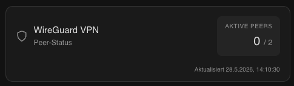
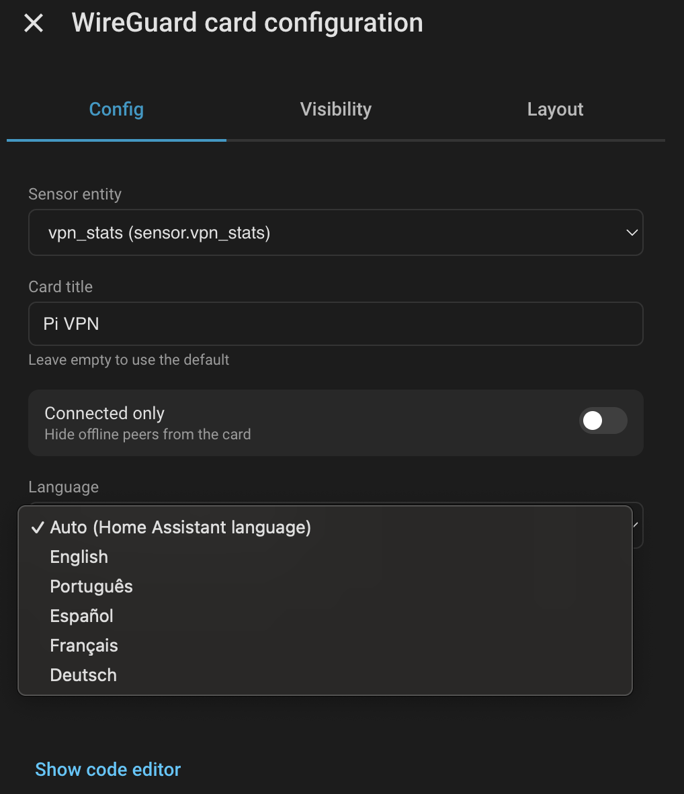

# Home Assistant WireGuard Karte

[English](README.md) · [Português](README.pt.md) · [Español](README.es.md) · [Français](README.fr.md) · **Deutsch**

Eine saubere, minimalistische Lovelace-Karte für [Home Assistant](https://www.home-assistant.io/), die den Status der WireGuard-VPN-Peers anzeigt — Verbindungsstatus, Endpunkte, Übertragungsstatistiken und Zeit des letzten Handshakes — in Echtzeit aktualisiert über einen REST-Sensor.

---

## Vorschau




| Peer online | Peer offline |
|---|---|
| Grüner Punkt · `online`-Plakette · Handshake in Sekunden | Grauer Punkt · `offline`-Plakette · Handshake in Stunden |

Jede Peer-Karte zeigt:
- **Verbindungsstatus** — farbcodierter Punkt und Plakette
- **Endpunkt** — öffentliche IP und Port
- **Erlaubte IPs** — Tunneladresse des Peers
- **Letzter Handshake** — in lesbarer Form, grün hervorgehoben wenn der Peer online ist
- **Übertragungsstatistiken** — rx / tx in lesbaren Einheiten

---

## Kein YAML erforderlich

Die Karte enthält einen integrierten **visuellen Editor**, sodass Sie sie direkt über die Dashboard-UI konfigurieren können — ohne YAML zu bearbeiten. Im Editor können Sie Folgendes ändern:

- **Sensor-Entität** — wählen Sie die Entität `sensor.vpn_stats`, die die Karte speist
- **Kartentitel** — überschreiben Sie den Titel der Kopfzeile, oder lassen Sie ihn leer für den lokalisierten Standard
- **Nur verbundene** — aktivieren, um Offline-Peers auszublenden
- **Sprache** — erzwingen Sie die UI-Sprache der Karte, oder lassen Sie sie auf `Automatisch`, um Home Assistant zu folgen
- **Statistik-API einrichten** — erzeugen Sie einen Zugriffsschlüssel und erhalten Sie einen kopierfertigen Installationsbefehl für Ihren WireGuard-Server

### Visueller Editor

Die Karte bringt einen visuellen Editor mit, sodass Sie sie direkt über die Dashboard-UI konfigurieren können, ohne YAML anzufassen:

- **Sensor-Entität** — Dropdown zur Auswahl der `sensor.vpn_stats`-Entität
- **Kartentitel** — optionales Textfeld zum Überschreiben des Header-Titels; leer lassen, um den lokalisierten Standard zu verwenden
- **Nur verbundene** — Schalter, um Offline-Peers aus der Karte auszublenden
- **Sprache** — Dropdown zum Überschreiben der Kartensprache; Standard: `Automatisch (Home Assistant Sprache)`
| 
### Sprachen

Die Karte übersetzt ihre Beschriftungen derzeit in folgende Sprachen:

| Code | Sprache |
|---|---|
| `en` | English (Standard-Fallback) |
| `pt` | Português |
| `es` | Español |
| `fr` | Français |
| `de` | Deutsch |

Verhalten:

- Wenn `language` in der Kartenkonfiguration gesetzt ist und einem der obigen Codes entspricht, wird diese Sprache verwendet.
- Andernfalls liest die Karte `hass.locale.language` (die Home-Assistant-Benutzersprache). Regionssuffixe wie `pt-BR` oder `en-US` werden auf ihre Basissprache reduziert (`pt`, `en`).
- Wenn die aufgelöste Sprache nicht in der obigen Liste ist, fällt die Karte auf Englisch zurück.
- Der Footer-Zeitstempel wird ebenfalls mit `toLocaleString(language)` formatiert, sodass das Datums-/Zeitformat der aufgelösten Sprache folgt.

> Handshake-Zeiten und Transfermengen formatiert die Karte in der ermittelten Sprache (z. B. `vor 5 Minuten`, `1,50 GiB`), wenn die API die Rohfelder `latest_handshake_at` und `transfer_*_bytes` sendet, wie es das mitgelieferte `wg-stats.py` tut. Sendet Ihre API nur den Text `latest_handshake` / `transfer_*_human`, wird dieser unverändert angezeigt.

---

## Voraussetzungen

| Voraussetzung | Hinweise |
|---|---|
| Home Assistant | 2023.x oder höher |
| Ein WireGuard-API-Endpunkt | Muss das unten beschriebene JSON-Format bereitstellen — Einrichtungsanleitung weiter unten |

---

## Installation

### HACS (empfohlen)

[](https://my.home-assistant.io/redirect/hacs_repository/?owner=filipeamorimdev&repository=home-assistant-wireguard-card&category=plugin)

1. Klicken Sie auf die Schaltfläche oben oder öffnen Sie in HACS **⋮ → Benutzerdefinierte Repositories** und fügen Sie `https://github.com/filipeamorimdev/home-assistant-wireguard-card` mit dem Typ **Dashboard** hinzu
2. Suchen Sie in HACS nach **WireGuard Card** und klicken Sie auf **Download**
3. HACS fügt die Dashboard-Ressource automatisch hinzu — aktualisieren Sie den Browser hart (`Ctrl+Shift+R`)

### Manuell

1. Laden Sie `wireguard-card.js` aus dem [neuesten Release](../../releases/latest) herunter
2. Kopieren Sie es nach `/config/www/wireguard-card.js`
3. Gehen Sie zu **Einstellungen → Dashboards → ⋮ → Ressourcen → Ressource hinzufügen**
   - URL: `/local/wireguard-card.js`
   - Typ: `JavaScript-Modul`
4. Aktualisieren Sie den Browser hart (`Ctrl+Shift+R`)

---

## API

Diese Karte liest von einem REST-Sensor, der einen JSON-Endpunkt abfragt. Der Endpunkt muss folgende Struktur zurückgeben:

```json
{
  "active_peers": 1,
  "total_peers": 2,
  "peers": {
    "peer-name": {
      "friendly_name": "peer-name",
      "endpoint": "1.2.3.4:51820",
      "allowed_ips": "10.0.0.2/32",
      "latest_handshake": "21 seconds",
      "latest_handshake_at": "2026-05-20T22:54:39+00:00",
      "transfer_rx_bytes": 3365929,
      "transfer_tx_bytes": 143843655,
      "transfer_rx_human": "3.21 MiB",
      "transfer_tx_human": "137.18 MiB",
      "rx_rate": 1520,
      "tx_rate": 48211,
      "connected": true,
      "connected_since": "2026-05-20T21:10:02+00:00"
    }
  },
  "updated_at": "2026-05-20T22:55:00.281068+00:00"
}
```

### Felder auf oberster Ebene

| Feld | Erforderlich | Hinweise |
|---|---|---|
| `peers` | ✅ | Objekt mit Peer-Namen als Schlüsseln. Die Karte iteriert über dessen Werte |
| `active_peers` | — | Wird in der Header-Statistik angezeigt. Greift auf den Sensorstatus zurück, wenn weggelassen |
| `total_peers` | — | Wird neben `active_peers` angezeigt. Greift auf die Anzahl der Einträge in `peers` zurück, wenn weggelassen |
| `updated_at` | — | ISO-Zeitstempel im Footer. Der Footer wird ausgeblendet, wenn weggelassen |
| `error` | — | Wird als Fehlerhinweis angezeigt, wenn vorhanden. Das mitgelieferte Skript setzt es, wenn `wg` fehlschlägt |

### Felder pro Peer

| Feld | Erforderlich | Hinweise |
|---|---|---|
| `friendly_name` | ✅ | Wird als Peer-Titel angezeigt |
| `endpoint` | ✅ | Wird unverändert angezeigt (z. B. `1.2.3.4:51820`) |
| `allowed_ips` | ✅ | Wird unverändert angezeigt (z. B. `10.0.0.2/32`) |
| `connected` | ✅ | Boolean. Steuert den Online/Offline-Indikator und den `connected_only`-Filter |
| `latest_handshake_at` | — | ISO-Zeitstempel des letzten Handshakes. Wird als „vor x Sekunden" in der Sprache der Karte angezeigt und jede Sekunde aktualisiert |
| `latest_handshake` | — | Text, der unverändert angezeigt wird, wenn `latest_handshake_at` fehlt. Ist keines gesetzt, zeigt die Karte „nie" |
| `transfer_rx_bytes` / `transfer_tx_bytes` | — | Byte-Zähler, von der Karte formatiert (z. B. `1,50 GiB`) |
| `transfer_rx_human` / `transfer_tx_human` | — | Text, der unverändert angezeigt wird, wenn die Byte-Zähler fehlen |
| `rx_rate` / `tx_rate` | — | Aktueller Durchsatz in Bytes pro Sekunde, neben den Summen verbundener Peers angezeigt |
| `connected_since` | — | ISO-Zeitstempel des Beginns der aktuellen Sitzung. Wird bei verbundenen Peers als „Online seit" angezeigt |

Das mitgelieferte Skript liefert außerdem `latest_handshake_seconds_ago`, `public_key`, `persistent_keepalive`, `preshared_key` (ob der Peer einen verwendet) und ein `interface`-Objekt auf oberster Ebene mit Listen-Port, öffentlichem Schlüssel, Gesamtbytes und Gesamtdurchsatz. Die Karte ignoriert diese Felder, Sie können sie aber in Templates verwenden (fügen Sie `interface` zu `json_attributes` hinzu, um es zu erhalten). Alle anderen zusätzlichen Felder werden ebenfalls ignoriert.

`rx_rate`, `tx_rate` und `connected_since` werden zwischen zwei Abfragen gemessen und sind daher `null`, bis das Skript den Peer mindestens zweimal gesehen hat. `connected_since` bleibt `null` für Sitzungen, die beim Start des Skripts schon bestanden.


## Einrichtung des WireGuard-Statistik-API-Dienstes

Folgen Sie diesen Schritten, um eine einfache JSON-API für den WireGuard-Status einzurichten, die sich mit Home Assistant integriert.

### Schnellinstallation (empfohlen)

Das Skript [`install.sh`](src/install.sh) erledigt alle manuellen Schritte unten für Sie, auf jedem Linux mit systemd (Debian, Ubuntu, Raspberry Pi OS, Fedora, Arch…). Es:

- prüft, ob `python3` (3.7+) und `wg` vorhanden sind, und erkennt Ihre WireGuard-Schnittstelle
- installiert `wg-stats.py` und den systemd-Dienst, startet ihn und prüft, ob er antwortet
- lauscht standardmäßig auf Ihrer LAN-IP und erzeugt ein Zugriffstoken, gespeichert in `/etc/default/wg-stats` (nur für root lesbar)
- gibt die Home-Assistant-Sensorkonfiguration zum Einfügen aus, mit Ihrer Adresse und Ihrem Token

Laden Sie es herunter, lesen Sie es und führen Sie es auf dem WireGuard-Server aus:

```bash
curl -fsSLO https://github.com/filipeamorimdev/home-assistant-wireguard-card/releases/latest/download/install.sh
less install.sh
sudo bash install.sh
```

Oder in einer Zeile:

```bash
curl -fsSL https://github.com/filipeamorimdev/home-assistant-wireguard-card/releases/latest/download/install.sh | sudo bash
```

| Befehl | Was er tut |
|---|---|
| `sudo bash install.sh` | Installiert, oder ändert die Einstellungen einer bestehenden Installation (die aktuellen Werte sind die Vorgaben) |
| `sudo bash install.sh upgrade` | Aktualisiert Skript und Dienst auf das heruntergeladene Release, Einstellungen und Token bleiben erhalten |
| `sudo bash install.sh --new-token` | Ersetzt das Zugriffstoken (danach `secrets.yaml` anpassen) |
| `sudo bash install.sh --token SCHLÜSSEL` | Verwendet einen vorhandenen Zugriffsschlüssel, z. B. den im Karteneditor erzeugten |
| `sudo bash install.sh uninstall` | Stoppt und entfernt den Dienst. Mit `--purge` werden auch Einstellungen und Token gelöscht |

Mit `bash install.sh --help` sehen Sie alle Optionen, z. B. `--interface wg1 --listen 192.168.1.10 --port 8888 --yes` für eine Installation ohne Rückfragen.

### Geführte Einrichtung aus Home Assistant

Sie möchten lieber in Home Assistant beginnen? Der Karteneditor erstellt den Zugriffsschlüssel und gibt Ihnen den Installationsbefehl mit bereits eingesetztem Schlüssel. Der Schlüssel wird in Ihrem Browser erzeugt und nie in der Kartenkonfiguration gespeichert.

1. **Karte hinzufügen.** Installieren Sie die Karte ([HACS](#hacs-empfohlen) oder [manuell](#manuell)), öffnen Sie ein Dashboard, klicken Sie auf **Dashboard bearbeiten → Karte hinzufügen** und wählen Sie **WireGuard Card**. Ein Fehler in der Vorschau ist vorerst normal, da der Sensor noch nicht existiert.
2. **Schlüssel erzeugen.** Klappen Sie unten im Karteneditor **Statistik-API einrichten** auf und klicken Sie auf **Zugriffsschlüssel erzeugen**. Lassen Sie den Editor geöffnet, bis Sie beide Zeilen unten kopiert haben. Wenn Sie ihn schließen, erzeugen Sie einfach einen neuen Schlüssel.
3. **Auf dem WireGuard-Server installieren.** Kopieren Sie den Installationsbefehl, öffnen Sie ein Terminal auf dem Rechner, auf dem WireGuard läuft (z. B. per SSH), und fügen Sie ihn ein. Der Installer stellt ein paar Fragen: Drücken Sie Enter, um die Standardwerte zu übernehmen (wählen Sie `127.0.0.1` als Adresse nur, wenn Home Assistant auf demselben Rechner läuft). Am Ende prüft er, ob die API antwortet, und gibt eine Sensor-Konfiguration aus. Lassen Sie diese Ausgabe geöffnet.
4. **Schlüssel in Home Assistant speichern.** Kopieren Sie die zweite Zeile aus dem Karteneditor (`wg_stats_auth: "Bearer …"`) und fügen Sie sie in die `secrets.yaml` im Konfigurationsordner von Home Assistant ein (z. B. mit dem Add-on File editor oder Studio Code Server).
5. **Sensor hinzufügen.** Fügen Sie den vom Installer ausgegebenen `sensor:`-Block in die `configuration.yaml` ein. Wenn Sie bereits einen `sensor:`-Abschnitt haben, fügen Sie darunter nur die Zeilen ab `- platform: rest` ein. Die vom Installer ausgegebene `secrets.yaml`-Zeile können Sie ignorieren: Sie haben sie in Schritt 4 eingetragen.
6. **Home Assistant neu starten.** Gehen Sie zu **Einstellungen → System → Neu starten** (oder zuerst zu **Entwicklerwerkzeuge → YAML → Konfiguration prüfen**, um Tippfehler zu finden).
7. **Sensor auswählen.** Bearbeiten Sie die Karte erneut, wählen Sie unter **Sensor-Entität** **sensor.vpn_stats** und klicken Sie auf **Speichern**. Ihre Peers erscheinen innerhalb von `scan_interval` Sekunden (standardmäßig 10).

Optional: [Halten Sie die Datenbank klein](#datenbank-klein-halten), indem Sie den Sensor vom Recorder ausschließen.

Funktioniert es nicht? Testen Sie die API vom Home-Assistant-Rechner aus und ersetzen Sie Adresse und Schlüssel durch Ihre eigenen. Ein `401` bedeutet, dass der Schlüssel in der `secrets.yaml` nicht mit dem auf dem Server übereinstimmt: Führen Sie den Installationsbefehl mit dem Schlüssel aus der `secrets.yaml` erneut aus, oder erzeugen Sie einen neuen Schlüssel und aktualisieren Sie beide Stellen.

```bash
curl -H "Authorization: Bearer <schlüssel>" http://<ip-des-wireguard-servers>:8888
```

### Manuelle Installation

Lieber alles von Hand einrichten? Folgen Sie diesen Schritten.

#### 1. API-Skript erstellen

Erstellen Sie das API-Skript mit Ihrem bevorzugten Editor:

```bash
sudo nano /usr/local/bin/wg-stats.py
```

Ein Beispielskript finden Sie unter [`src/wg-stats.py`](src/wg-stats.py).  
Passen Sie es bei Bedarf an Ihre Umgebung an.

#### 2. Skript ausführbar machen

```bash
sudo chmod +x /usr/local/bin/wg-stats.py
```

#### 3. systemd-Dienst erstellen

Richten Sie einen Dienst ein, der Ihr Skript automatisch ausführt:

```bash
sudo nano /etc/systemd/system/wg-stats.service
```

Eine Beispiel-[`wg-stats.service`](src/wg-stats.service) ist in diesem Repository als Referenz verfügbar.  
Achten Sie darauf, `ExecStart` zu aktualisieren, falls Ihr Python-Pfad anders ist.

#### 4. systemd neu laden

Laden Sie systemd neu, damit es den neuen Dienst erkennt:

```bash
sudo systemctl daemon-reload
```

#### 5. Dienst beim Start aktivieren

Aktivieren Sie den Dienst, sodass er beim Systemstart läuft:

```bash
sudo systemctl enable wg-stats
```

#### 6. Dienst starten

Starten Sie den WireGuard-Statistikdienst sofort:

```bash
sudo systemctl start wg-stats
```

#### 7. Überprüfen, dass alles funktioniert

Prüfen Sie den Dienststatus:

```bash
sudo systemctl status wg-stats
```

Sie sollten sehen, dass der Dienst aktiv (läuft) ist.  
Wenn ja, ist Ihr API-Endpunkt jetzt bereit, von Home Assistant verwendet zu werden.

> ⚠️ **Sicherheitshinweis:** Das Beispiel-`wg-stats.py` lauscht auf `0.0.0.0:8888` **ohne Authentifizierung und ohne TLS**, sodass jeder Host im selben Netzwerk Ihre WireGuard-Topologie auslesen kann — Peer-Namen, Endpunkte, erlaubte IPs und Transferstatistiken. Bevor Sie es freigeben, sollten Sie eine oder mehrere der folgenden Optionen in Betracht ziehen:
> - Setzen Sie `WG_STATS_LISTEN` (z. B. in `/etc/default/wg-stats`), um auf einer bestimmten Adresse statt `0.0.0.0` zu lauschen — Ihrer reinen LAN-IP oder `127.0.0.1`, wenn Home Assistant auf demselben Host läuft.
> - Setzen Sie `WG_STATS_TOKEN`, um einen `Authorization: Bearer <token>`-Header zu verlangen — z. B. `WG_STATS_TOKEN=<lange Zufallszeichenkette>` in `/etc/default/wg-stats` (`chmod 600`), danach `sudo systemctl restart wg-stats` — und ergänzen Sie die passenden `headers` im REST-Sensor (siehe unten).
> - Beschränken Sie den Zugriff mit einer Firewall-Regel, die nur Ihren Home-Assistant-Host zulässt.
> - Geben Sie Port `8888` niemals direkt ins Internet frei. Falls Fernzugriff nötig ist, stellen Sie ihn hinter einen Reverse-Proxy mit Authentifizierung/TLS oder greifen Sie über das VPN selbst darauf zu.
>
> Die Schnellinstallation setzt die ersten beiden Punkte für Sie um.

---

## Sensor-Konfiguration

> Schnellinstallation verwendet? Sie hat diesen Block bereits mit Ihrer Adresse und Ihrem Token ausgegeben — fügen Sie den ein.

Fügen Sie Folgendes zu Ihrer `configuration.yaml` hinzu:

```yaml
sensor:
  - platform: rest
    name: vpn_stats
    unique_id: wireguard_vpn_stats
    resource: http://<ihr-api-host>:<port>
    scan_interval: 10
    # Nur wenn WG_STATS_TOKEN auf dem API-Host gesetzt ist:
    # headers:
    #   Authorization: !secret wg_stats_auth   # "Bearer <token>" in secrets.yaml
    value_template: "{{ value_json.active_peers }}"
    unit_of_measurement: peers
    json_attributes:
      - active_peers
      - total_peers
      - peers
      - updated_at
      - error
```

Ersetzen Sie `<ihr-api-host>:<port>` durch die Adresse Ihrer WireGuard-API.

| Feld | Beschreibung |
|---|---|
| `unique_id` | Ermöglicht die Verwaltung der Entität über die UI |
| `scan_interval` | Abfragefrequenz in Sekunden — 10 ist ein vernünftiger Standardwert |
| `value_template` | Setzt den Sensorstatus auf die Anzahl der aktiven Peers |
| `unit_of_measurement` | Beschriftet den Statuswert in Verlauf und Logbuch |
| `json_attributes` | Holt verschachtelte Daten als Entitätsattribute, damit die Karte sie lesen kann |

Nach dem Bearbeiten der `configuration.yaml` laden Sie Ihre HA-Konfiguration neu (**Entwicklerwerkzeuge → YAML → Gesamtes YAML neu laden**) oder starten Sie Home Assistant neu.

### Datenbank klein halten

Das Attribut `peers` ändert sich bei jeder Abfrage (Handshake-Zeiten, Durchsatz, `updated_at`), daher speichert der Recorder von Home Assistant bei jedem `scan_interval` eine neue Kopie: bei 10 Sekunden etwa 8.600 Kopien pro Tag. Außerdem speichert Home Assistant keine Attribute über 16 KB, was dieser Sensor ab etwa 25 Peers erreicht.

Die Karte braucht nur den aktuellen Zustand, schließen Sie den Sensor also vom Recorder aus:

```yaml
recorder:
  exclude:
    entities:
      - sensor.vpn_stats
```

Dadurch entfällt auch der Verlauf der Anzahl aktiver Peers. Wenn Sie ihn behalten möchten, legen Sie einen Template-Sensor mit `state: "{{ states('sensor.vpn_stats') }}"` an. Er speichert nur die Zahl, ohne die Attribute.

---

## Karten-Konfiguration

Fügen Sie die Karte zu einem beliebigen Lovelace-Dashboard hinzu:

```yaml
type: custom:wireguard-card
entity: sensor.vpn_stats
```

Beim Hinzufügen der Karte über die Kartenauswahl wird die erste `sensor.*`-Entität mit einem `peers`-Attribut vorausgewählt (ersatzweise eine, deren ID `vpn` enthält) — meist `sensor.vpn_stats` — sodass Sie oft ohne Änderungen bestätigen können.

### Optionen

| Option | Erforderlich | Standard | Beschreibung |
|---|---|---|---|
| `entity` | ✅ | — | Die oben erstellte `sensor.vpn_stats`-Entität |
| `title` | — | _lokalisiert_ `"WireGuard VPN"` | Eigener Text als Titel im Kartenkopf. Wird er weggelassen, wird der lokalisierte Standard verwendet |
| `connected_only` | — | `false` | Bei `true` werden Peers ausgeblendet, deren `connected`-Feld nicht `true` ist; es bleiben nur die aktuell verbundenen übrig |
| `language` | — | _Home-Assistant-Benutzersprache_ | Erzwingt die UI-Sprache der Karte. Siehe [Sprachen](#sprachen) für unterstützte Werte. Wird sie weggelassen, nutzt die Karte die Home-Assistant-Benutzersprache und fällt auf Englisch zurück, wenn nicht unterstützt |

Beispiel mit eigenem Titel, ausgeblendeten Offline-Peers und auf Portugiesisch erzwungener UI:

```yaml
type: custom:wireguard-card
entity: sensor.vpn_stats
title: Heim-VPN
connected_only: true
language: pt
```

---

## Fehlerbehebung

**Karte zeigt „Entity not found"**
→ Prüfen Sie, ob der Sensor geladen ist und die Entitäts-ID exakt übereinstimmt (standardmäßig `sensor.vpn_stats`).

**Peers werden nicht angezeigt**
→ Bestätigen Sie, dass `peers` unter `json_attributes` in der Sensorkonfiguration aufgeführt ist und die API ein gültiges JSON-Objekt unter diesem Schlüssel zurückgibt.

**Daten sind veraltet**
→ Prüfen Sie den `updated_at`-Zeitstempel unten an der Karte. Wenn er sich nicht aktualisiert, prüfen Sie, ob die API von HA aus erreichbar ist und `scan_interval` gesetzt ist.

**Karte erscheint nicht in der Kartenauswahl**
→ Stellen Sie sicher, dass die Ressource korrekt hinzugefügt wurde und Sie einen harten Refresh (`Ctrl+Shift+R`) durchgeführt haben.

**Die Karte zeigt „API-Fehler“**
→ Der Dienst `wg-stats` konnte den WireGuard-Status nicht lesen. Details mit `sudo journalctl -u wg-stats` prüfen (falsches `WG_STATS_INTERFACE`, `wg` nicht installiert usw.).

---

## Mitwirken

Pull Requests sind willkommen. Bitte öffnen Sie zuerst ein Issue für größere Änderungen.
