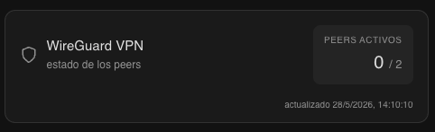
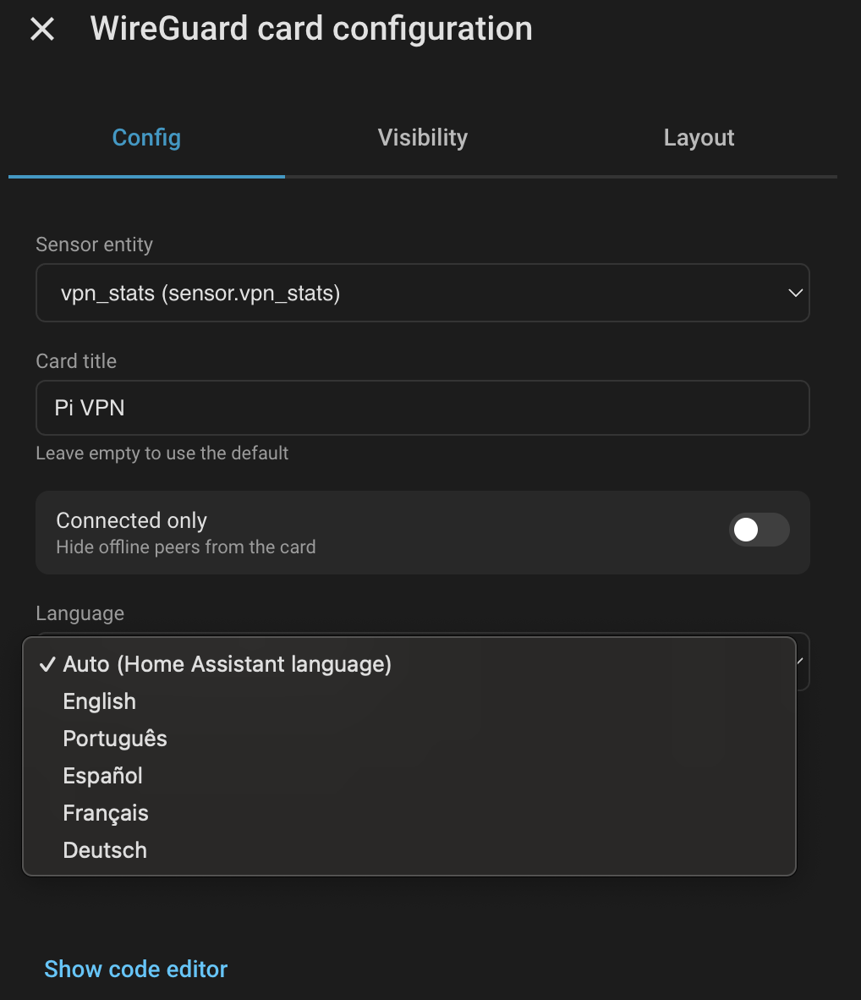

# Home Assistant Tarjeta WireGuard

[English](README.md) · [Português](README.pt.md) · **Español** · [Français](README.fr.md) · [Deutsch](README.de.md)

Una tarjeta Lovelace limpia y minimalista para [Home Assistant](https://www.home-assistant.io/) que muestra el estado de los peers de WireGuard VPN — estado de la conexión, endpoints, estadísticas de transferencia y hora del último handshake — actualizado en tiempo real desde un sensor REST.

---

## Vista previa




| Peer en línea | Peer desconectado |
|---|---|
| Punto verde · etiqueta `online` · handshake en segundos | Punto gris · etiqueta `offline` · handshake en horas |

Cada tarjeta de peer muestra:
- **Estado de conexión** — punto y etiqueta con código de color
- **Endpoint** — IP pública y puerto
- **IPs permitidas** — la dirección del túnel del peer
- **Último handshake** — en formato legible, resaltado en verde cuando el peer está en línea
- **Estadísticas de transferencia** — rx / tx en unidades legibles

---

## Sin YAML necesario

La tarjeta incluye un **editor visual** integrado, así que puedes configurarla directamente desde la UI del panel — sin editar YAML. Desde el editor puedes cambiar:

- **Entidad del sensor** — elige la entidad `sensor.vpn_stats` que alimenta la tarjeta
- **Título de la tarjeta** — sustituye el título del encabezado, o déjalo vacío para usar el predeterminado localizado
- **Solo conectados** — actívalo para ocultar los peers desconectados
- **Idioma** — fuerza el idioma de la UI de la tarjeta, o déjalo en `Automático` para seguir a Home Assistant
- **Configurar la API de estadísticas** — genera una clave de acceso y obtén un comando de instalación listo para copiar en tu servidor WireGuard

### Editor visual

La tarjeta incluye un editor visual, para que puedas configurarla directamente desde la UI del panel sin tocar YAML:

- **Entidad del sensor** — menú desplegable para elegir la entidad `sensor.vpn_stats`
- **Título de la tarjeta** — campo de texto opcional para sobrescribir el título de la cabecera; déjalo vacío para usar el valor predeterminado localizado
- **Solo conectados** — interruptor para ocultar peers desconectados de la tarjeta
- **Idioma** — menú desplegable para sobrescribir el idioma de la tarjeta; por defecto `Automático (idioma de Home Assistant)`
| 
### Idiomas

La tarjeta actualmente traduce sus etiquetas a los siguientes idiomas:

| Código | Idioma |
|---|---|
| `en` | English (idioma por defecto) |
| `pt` | Português |
| `es` | Español |
| `fr` | Français |
| `de` | Deutsch |

Comportamiento:

- Si `language` está definido en la configuración de la tarjeta y coincide con uno de los códigos anteriores, se usa ese idioma.
- En caso contrario, la tarjeta lee `hass.locale.language` (el idioma del usuario de Home Assistant). Los sufijos regionales como `pt-BR` o `en-US` se reducen a su idioma base (`pt`, `en`).
- Si el idioma resuelto no está en la lista anterior, la tarjeta recurre al inglés.
- El timestamp del pie también se formatea con `toLocaleString(language)`, por lo que el formato de fecha/hora sigue el idioma resuelto.

> Los tiempos de handshake y los volúmenes de transferencia los formatea la tarjeta en el idioma resuelto (p. ej. `hace 5 minutos`, `1,50 GiB`) cuando la API envía los campos en bruto `latest_handshake_at` y `transfer_*_bytes`, como hace el `wg-stats.py` incluido. Si tu API solo envía el texto `latest_handshake` / `transfer_*_human`, ese texto se muestra tal cual.

---

## Requisitos

| Requisito | Notas |
|---|---|
| Home Assistant | 2023.x o posterior |
| Un endpoint de la API de WireGuard | Debe exponer el formato JSON descrito abajo — instrucciones de configuración más adelante |

---

## Instalación

### HACS (recomendado)

[](https://my.home-assistant.io/redirect/hacs_repository/?owner=filipeamorimdev&repository=home-assistant-wireguard-card&category=plugin)

1. Haz clic en el botón de arriba o, en HACS, abre **⋮ → Repositorios personalizados** y añade `https://github.com/filipeamorimdev/home-assistant-wireguard-card` con el tipo **Dashboard**
2. Busca **WireGuard Card** en HACS y haz clic en **Download**
3. HACS añade el recurso del panel automáticamente — recarga el navegador con un refresh forzado (`Ctrl+Shift+R`)

### Manual

1. Descarga `wireguard-card.js` desde la [última versión](../../releases/latest)
2. Cópialo a `/config/www/wireguard-card.js`
3. Ve a **Ajustes → Paneles → ⋮ → Recursos → Añadir recurso**
   - URL: `/local/wireguard-card.js`
   - Tipo: `Módulo JavaScript`
4. Recarga el navegador con un refresh forzado (`Ctrl+Shift+R`)

---

## API

Esta tarjeta lee desde un sensor REST que consulta un endpoint JSON. El endpoint debe devolver la siguiente estructura:

```json
{
  "active_peers": 1,
  "total_peers": 2,
  "peers": {
    "peer-name": {
      "friendly_name": "peer-name",
      "endpoint": "1.2.3.4:51820",
      "allowed_ips": "10.0.0.2/32",
      "latest_handshake": "21 seconds",
      "latest_handshake_at": "2026-05-20T22:54:39+00:00",
      "transfer_rx_bytes": 3365929,
      "transfer_tx_bytes": 143843655,
      "transfer_rx_human": "3.21 MiB",
      "transfer_tx_human": "137.18 MiB",
      "rx_rate": 1520,
      "tx_rate": 48211,
      "connected": true,
      "connected_since": "2026-05-20T21:10:02+00:00"
    }
  },
  "updated_at": "2026-05-20T22:55:00.281068+00:00"
}
```

### Campos de nivel superior

| Campo | Obligatorio | Notas |
|---|---|---|
| `peers` | ✅ | Objeto indexado por nombre de peer. La tarjeta itera sobre sus valores |
| `active_peers` | — | Mostrado en la estadística del encabezado. Recurre al estado del sensor si se omite |
| `total_peers` | — | Mostrado junto a `active_peers`. Recurre al número de entradas en `peers` si se omite |
| `updated_at` | — | Timestamp ISO mostrado en el pie. El pie se oculta si se omite |
| `error` | — | Se muestra como aviso de error cuando está presente. El script incluido lo define cuando `wg` falla |

### Campos por peer

| Campo | Obligatorio | Notas |
|---|---|---|
| `friendly_name` | ✅ | Mostrado como el título del peer |
| `endpoint` | ✅ | Mostrado tal cual (p. ej. `1.2.3.4:51820`) |
| `allowed_ips` | ✅ | Mostrado tal cual (p. ej. `10.0.0.2/32`) |
| `connected` | ✅ | Booleano. Controla el indicador en línea/desconectado y el filtro `connected_only` |
| `latest_handshake_at` | — | Timestamp ISO del último handshake. Se muestra como "hace x segundos" en el idioma de la tarjeta, actualizado cada segundo |
| `latest_handshake` | — | Texto mostrado tal cual cuando falta `latest_handshake_at`. Si no hay ninguno, la tarjeta muestra "nunca" |
| `transfer_rx_bytes` / `transfer_tx_bytes` | — | Contadores de bytes, formateados por la tarjeta (p. ej. `1,50 GiB`) |
| `transfer_rx_human` / `transfer_tx_human` | — | Texto mostrado tal cual cuando faltan los contadores de bytes |
| `rx_rate` / `tx_rate` | — | Tasa de transferencia actual en bytes por segundo, mostrada junto a los totales de los peers en línea |
| `connected_since` | — | Timestamp ISO del inicio de la sesión actual. Se muestra como "en línea desde hace" en los peers en línea |

El script incluido también devuelve `latest_handshake_seconds_ago`, `public_key`, `persistent_keepalive`, `preshared_key` (si el peer usa una) y un objeto `interface` de primer nivel con el puerto de escucha, la clave pública, el total de bytes y la tasa total. La tarjeta los ignora, pero puedes usarlos en plantillas (añade `interface` a `json_attributes` para obtenerlo). Cualquier otro campo extra también se ignora.

`rx_rate`, `tx_rate` y `connected_since` se miden entre consultas, así que son `null` hasta que el script haya visto el peer al menos dos veces. `connected_since` queda en `null` para sesiones que ya estaban activas cuando arrancó el script.


## Configurar el servicio de la API de estadísticas de WireGuard

Sigue estos pasos para configurar una API JSON sencilla para el estado de WireGuard que se integre con Home Assistant.

### Instalación rápida (recomendado)

El script [`install.sh`](src/install.sh) hace por ti todos los pasos manuales de abajo en cualquier Linux con systemd (Debian, Ubuntu, Raspberry Pi OS, Fedora, Arch…). El script:

- comprueba que existan `python3` (3.7+) y `wg`, y detecta tu interfaz WireGuard
- instala `wg-stats.py` y el servicio systemd, lo inicia y comprueba que responde
- por defecto escucha en la IP de tu LAN y genera un token de acceso, guardado en `/etc/default/wg-stats` (legible solo por root)
- muestra la configuración del sensor de Home Assistant lista para pegar, con tu dirección y token ya puestos

Descárgalo, léelo y ejecútalo en el servidor WireGuard:

```bash
curl -fsSLO https://github.com/filipeamorimdev/home-assistant-wireguard-card/releases/latest/download/install.sh
less install.sh
sudo bash install.sh
```

O en una sola línea:

```bash
curl -fsSL https://github.com/filipeamorimdev/home-assistant-wireguard-card/releases/latest/download/install.sh | sudo bash
```

| Comando | Qué hace |
|---|---|
| `sudo bash install.sh` | Instala, o cambia los ajustes de una instalación existente (los valores actuales son los predeterminados) |
| `sudo bash install.sh upgrade` | Actualiza el script y el servicio a la versión descargada, conservando los ajustes y el token |
| `sudo bash install.sh --new-token` | Sustituye el token de acceso (actualiza después `secrets.yaml`) |
| `sudo bash install.sh --token CLAVE` | Usa una clave de acceso que ya tienes, como la generada en el editor de la tarjeta |
| `sudo bash install.sh uninstall` | Detiene y elimina el servicio. Añade `--purge` para borrar también los ajustes y el token |

Ejecuta `bash install.sh --help` para ver todas las opciones, por ejemplo `--interface wg1 --listen 192.168.1.10 --port 8888 --yes` para una instalación sin preguntas.

### Configuración guiada desde Home Assistant

¿Prefieres empezar desde Home Assistant? El editor de la tarjeta crea la clave de acceso y te da el comando de instalación con ella ya incluida. La clave se genera en tu navegador y nunca se guarda en la configuración de la tarjeta.

1. **Añade la tarjeta.** Instala la tarjeta ([HACS](#hacs-recomendado) o [manual](#manual)), abre un panel, haz clic en **Editar panel → Añadir tarjeta** y elige **WireGuard Card**. Un error en la vista previa es normal por ahora, porque el sensor aún no existe.
2. **Genera una clave.** Al final del editor de la tarjeta, despliega **Configurar la API de estadísticas** y pulsa **Generar clave de acceso**. Mantén el editor abierto hasta copiar las dos líneas de abajo. Si lo cierras, basta con generar una clave nueva.
3. **Instala en el servidor WireGuard.** Copia el comando de instalación, abre una terminal en la máquina donde corre WireGuard (por ejemplo, por SSH) y pégalo. El instalador hace algunas preguntas: pulsa Enter para aceptar los valores predeterminados (elige `127.0.0.1` como dirección solo si Home Assistant corre en esa misma máquina). Al terminar, comprueba que la API responde y muestra una configuración del sensor. Deja esa salida abierta.
4. **Guarda la clave en Home Assistant.** Copia la segunda línea del editor de la tarjeta (`wg_stats_auth: "Bearer …"`) y añádela a `secrets.yaml` en la carpeta de configuración de Home Assistant (por ejemplo, con el complemento File editor o Studio Code Server).
5. **Añade el sensor.** Pega en `configuration.yaml` el bloque `sensor:` que mostró el instalador. Si ya tienes una sección `sensor:`, añade solo las líneas desde `- platform: rest` hacia abajo. Puedes ignorar la línea de `secrets.yaml` que muestra el instalador: ya la añadiste en el paso 4.
6. **Reinicia Home Assistant.** Ve a **Ajustes → Sistema → Reiniciar** (o antes a **Herramientas para desarrolladores → YAML → Comprobar configuración**, para detectar errores).
7. **Elige el sensor.** Edita de nuevo la tarjeta, elige **sensor.vpn_stats** en **Entidad del sensor** y pulsa **Guardar**. Los peers aparecen en `scan_interval` segundos (10 por defecto).

Opcional: [mantén la base de datos pequeña](#mantener-la-base-de-datos-pequeña) excluyendo el sensor del recorder.

¿No funciona? Prueba la API desde la máquina de Home Assistant, sustituyendo la dirección y la clave por las tuyas. Un `401` significa que la clave de `secrets.yaml` no coincide con la del servidor: vuelve a ejecutar el comando de instalación con la clave de `secrets.yaml`, o genera una clave nueva y actualiza ambos.

```bash
curl -H "Authorization: Bearer <clave>" http://<ip-del-servidor-wireguard>:8888
```

### Instalación manual

¿Prefieres configurarlo a mano? Sigue estos pasos.

#### 1. Crear el script de la API

Crea el script de la API con tu editor preferido:

```bash
sudo nano /usr/local/bin/wg-stats.py
```

Puedes encontrar un script de ejemplo en [`src/wg-stats.py`](src/wg-stats.py).  
Modifícalo según sea necesario para tu entorno.

#### 2. Hacer el script ejecutable

```bash
sudo chmod +x /usr/local/bin/wg-stats.py
```

#### 3. Crear un servicio systemd

Configura un servicio para ejecutar tu script automáticamente:

```bash
sudo nano /etc/systemd/system/wg-stats.service
```

Ejemplo de [`wg-stats.service`](src/wg-stats.service) disponible en este repositorio como referencia.  
Asegúrate de actualizar `ExecStart` si tu ruta de Python es diferente.

#### 4. Recargar systemd

Recarga systemd para que detecte el nuevo servicio:

```bash
sudo systemctl daemon-reload
```

#### 5. Habilitar el servicio en el arranque

Habilita el servicio para que se inicie automáticamente:

```bash
sudo systemctl enable wg-stats
```

#### 6. Iniciar el servicio

Inicia inmediatamente el servicio de estadísticas de WireGuard:

```bash
sudo systemctl start wg-stats
```

#### 7. Comprobar que todo funciona

Verifica el estado del servicio:

```bash
sudo systemctl status wg-stats
```

Deberías ver que el servicio está activo (corriendo).  
Si es así, tu endpoint de API ya está listo para ser usado por Home Assistant.

> ⚠️ **Nota de seguridad:** El `wg-stats.py` de ejemplo escucha en `0.0.0.0:8888` **sin autenticación ni TLS**, por lo que cualquier host en la misma red puede leer la topología de tu WireGuard — nombres de los peers, endpoints, IPs permitidas y estadísticas de transferencia. Antes de exponerlo, considera una o varias de las siguientes opciones:
> - Define `WG_STATS_LISTEN` (por ejemplo, en `/etc/default/wg-stats`) para escuchar en una dirección específica en lugar de `0.0.0.0` — la IP solo de tu LAN, o `127.0.0.1` si Home Assistant se ejecuta en el mismo host.
> - Define `WG_STATS_TOKEN` para exigir una cabecera `Authorization: Bearer <token>` — por ejemplo `WG_STATS_TOKEN=<cadena aleatoria larga>` en `/etc/default/wg-stats` (`chmod 600`), seguido de `sudo systemctl restart wg-stats` — y añade los `headers` correspondientes al sensor REST (ver abajo).
> - Restringe el acceso con una regla de firewall que permita solo tu host de Home Assistant.
> - Nunca expongas el puerto `8888` directamente a internet. Si necesitas acceso remoto, ponlo detrás de un proxy inverso con autenticación/TLS, o accede a través de la propia VPN.
>
> El instalador rápido aplica las dos primeras por ti.

---

## Configuración del sensor

> ¿Usaste el instalador rápido? Ya mostró este bloque con tu dirección y token — pega ese.

Añade lo siguiente a tu `configuration.yaml`:

```yaml
sensor:
  - platform: rest
    name: vpn_stats
    unique_id: wireguard_vpn_stats
    resource: http://<tu-host-de-api>:<puerto>
    scan_interval: 10
    # Solo si WG_STATS_TOKEN está definido en el host de la API:
    # headers:
    #   Authorization: !secret wg_stats_auth   # "Bearer <token>" en secrets.yaml
    value_template: "{{ value_json.active_peers }}"
    unit_of_measurement: peers
    json_attributes:
      - active_peers
      - total_peers
      - peers
      - updated_at
      - error
```

Sustituye `<tu-host-de-api>:<puerto>` por la dirección de tu API de WireGuard.

| Campo | Descripción |
|---|---|
| `unique_id` | Permite la gestión de la entidad desde la UI |
| `scan_interval` | Frecuencia de sondeo en segundos — 10 es un valor por defecto sensato |
| `value_template` | Define el estado del sensor como el número de peers activos |
| `unit_of_measurement` | Etiqueta el valor del estado en el historial y el diario |
| `json_attributes` | Extrae los datos anidados como atributos de la entidad para que la tarjeta los lea |

Después de editar `configuration.yaml`, recarga tu configuración de HA (**Herramientas para desarrolladores → YAML → Recargar todo el YAML**) o reinicia Home Assistant.

### Mantener la base de datos pequeña

El atributo `peers` cambia en cada consulta (tiempos de handshake, tasas de transferencia, `updated_at`), así que el recorder de Home Assistant guarda una copia nueva en cada `scan_interval`: unas 8600 copias al día con 10 segundos. Home Assistant además deja de grabar atributos de más de 16 KB, algo que este sensor alcanza a partir de unos 25 peers.

La tarjeta solo necesita el estado actual, así que excluye el sensor del recorder:

```yaml
recorder:
  exclude:
    entities:
      - sensor.vpn_stats
```

Esto también elimina el historial del número de peers activos. Si quieres conservarlo, crea un template sensor con `state: "{{ states('sensor.vpn_stats') }}"`. Solo graba el número, sin los atributos.

---

## Configuración de la tarjeta

Añade la tarjeta a cualquier panel Lovelace:

```yaml
type: custom:wireguard-card
entity: sensor.vpn_stats
```

Al añadir la tarjeta desde el selector de tarjetas, queda preseleccionada la primera entidad `sensor.*` que expone un atributo `peers` (o, en su defecto, una cuyo ID contenga `vpn`) — normalmente `sensor.vpn_stats` — así que a menudo basta con confirmar sin cambiar nada.

### Opciones

| Opción | Obligatorio | Por defecto | Descripción |
|---|---|---|---|
| `entity` | ✅ | — | La entidad `sensor.vpn_stats` creada arriba |
| `title` | — | _localizado_ `"WireGuard VPN"` | Texto personalizado mostrado como título de la cabecera de la tarjeta. Si se omite, se usa el valor predeterminado localizado |
| `connected_only` | — | `false` | Cuando es `true`, oculta los peers cuyo campo `connected` no sea `true`, dejando solo los actualmente conectados |
| `language` | — | _idioma del usuario de Home Assistant_ | Fuerza el idioma de la UI de la tarjeta. Consulta [Idiomas](#idiomas) para los valores soportados. Si se omite, la tarjeta usa el idioma del usuario de Home Assistant y recurre al inglés si no está soportado |

Ejemplo con un título personalizado, peers desconectados ocultos y la UI forzada en portugués:

```yaml
type: custom:wireguard-card
entity: sensor.vpn_stats
title: VPN de Casa
connected_only: true
language: pt
```

---

## Solución de problemas

**La tarjeta muestra "Entity not found"**
→ Comprueba que el sensor esté cargado y que el ID de la entidad coincida exactamente (`sensor.vpn_stats` por defecto).

**Los peers no aparecen**
→ Confirma que `peers` esté listado en `json_attributes` en la configuración del sensor y que la API esté devolviendo un objeto JSON válido bajo esa clave.

**Los datos están desactualizados**
→ Comprueba el timestamp `updated_at` mostrado al pie de la tarjeta. Si no se actualiza, verifica que la API sea accesible desde HA y que `scan_interval` esté definido.

**La tarjeta no aparece en el selector de tarjetas**
→ Asegúrate de que el recurso se añadió correctamente y de que has hecho un refresh forzado (`Ctrl+Shift+R`).

**La tarjeta muestra "Error de la API"**
→ El servicio `wg-stats` no pudo leer el estado de WireGuard. Consulta los detalles con `sudo journalctl -u wg-stats` (`WG_STATS_INTERFACE` incorrecta, `wg` no instalado, etc.).

---

## Contribuir

Las pull requests son bienvenidas. Por favor, abre primero una issue para cambios importantes.
