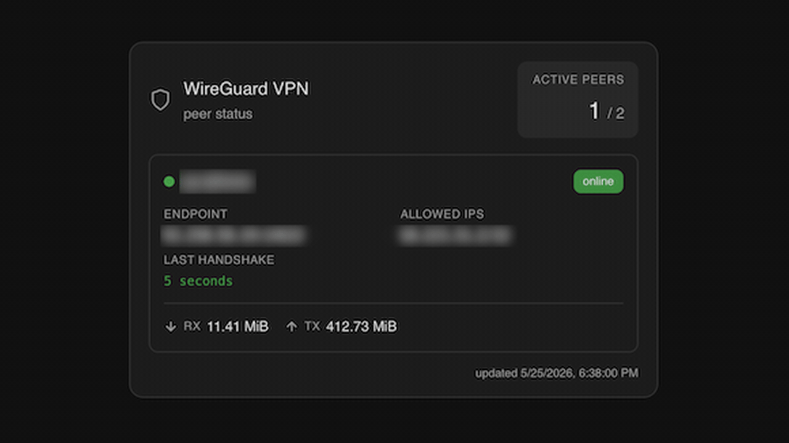
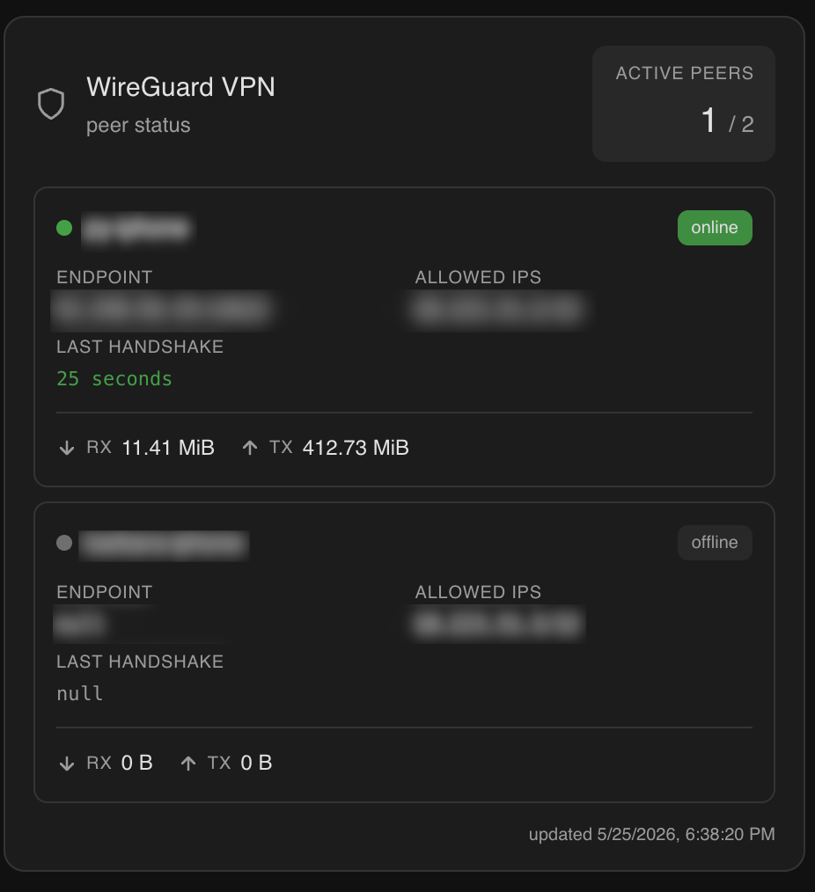
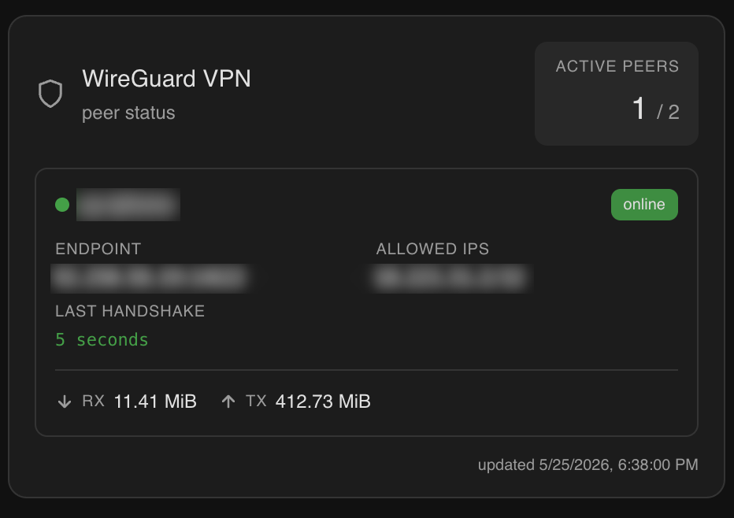
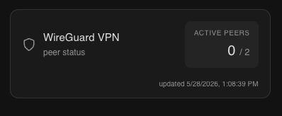
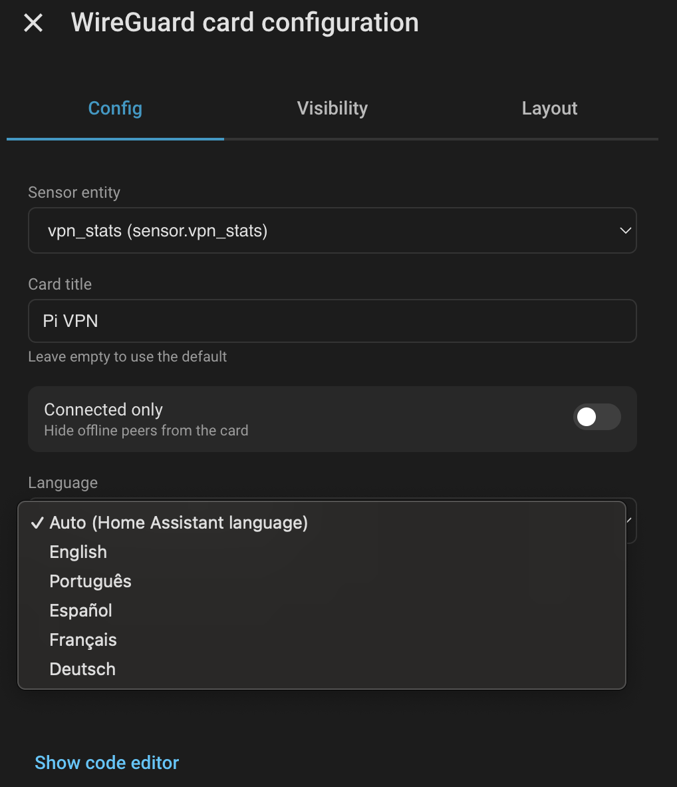

# Home Assistant WireGuard Card

[](https://github.com/filipeamorimdev/home-assistant-wireguard-card/releases/latest)
[](LICENSE)
[](https://github.com/filipeamorimdev/home-assistant-wireguard-card/stargazers)
[](https://hacs.xyz/)
[](https://www.home-assistant.io/)

**English** · [Português](README.pt.md) · [Español](README.es.md) · [Français](README.fr.md) · [Deutsch](README.de.md)

A clean, minimal Lovelace card for [Home Assistant](https://www.home-assistant.io/) that displays WireGuard VPN peer status — connection state, endpoints, transfer stats, and last handshake time — updated in real time from a REST sensor.



## Why this card?

- **See who's connected at a glance** — every peer gets a colour-coded online/offline indicator, so you don't need to SSH in and run `wg show`.
- **Works with plain WireGuard** — no add-on or integration needed. A small [Python script](src/wg-stats.py) (included) exposes `wg show` as JSON, and a standard REST sensor feeds the card.
- **No YAML required** — configure everything from the built-in visual editor.
- **Multilingual** — English, Português, Español, Français and Deutsch, following your Home Assistant language automatically.

---

## Preview




| Online peer | Offline peer |
|---|---|
| Green dot · `online` badge · handshake in seconds | Grey dot · `offline` badge · handshake in hours |





Each peer card shows:
- **Connection status** — colour-coded dot and badge
- **Endpoint** — public IP and port
- **Allowed IPs** — the peer's tunnel address
- **Last handshake** — human-readable, highlighted green when the peer is online
- **Transfer stats** — rx / tx in human-readable units

---

## No YAML required

The card ships with a built-in **visual editor**, so you can set it up directly from the dashboard UI — no YAML editing needed. From the editor you can change:

- **Sensor entity** — pick the `sensor.vpn_stats` entity that feeds the card
- **Card title** — override the header title, or leave it empty for the localized default
- **Connected only** — toggle to hide offline peers
- **Language** — force the card's UI language, or leave it on `Auto` to follow Home Assistant



### Languages

The card currently translates its labels into the following languages:

| Code | Language |
|---|---|
| `en` | English (default fallback) |
| `pt` | Português |
| `es` | Español |
| `fr` | Français |
| `de` | Deutsch |

Behaviour:

- If `language` is set in the card config and matches one of the codes above, that language is used.
- Otherwise, the card reads `hass.locale.language` (the user's Home Assistant language). Region suffixes like `pt-BR` or `en-US` are reduced to their base language (`pt`, `en`).
- If the resolved language is not in the list above, the card falls back to English.
- The footer timestamp is also formatted with `toLocaleString(language)`, so the date/time format follows the resolved language.

> Handshake times and transfer sizes are formatted by the card in the resolved language (e.g. `vor 5 Minuten`, `1,50 GiB`) when the API sends the raw `latest_handshake_at` and `transfer_*_bytes` fields, as the included `wg-stats.py` does. If your API only sends the `latest_handshake` / `transfer_*_human` text, that text is shown as-is.

---

## Requirements

| Requirement | Notes |
|---|---|
| Home Assistant | 2023.x or later |
| A WireGuard API endpoint | Must expose the JSON format described below — setup instructions further down |

---

## Installation

### HACS (recommended)

[](https://my.home-assistant.io/redirect/hacs_repository/?owner=filipeamorimdev&repository=home-assistant-wireguard-card&category=plugin)

1. Click the button above, or in HACS open **⋮ → Custom repositories** and add `https://github.com/filipeamorimdev/home-assistant-wireguard-card` with type **Dashboard**
2. Search for **WireGuard Card** in HACS and click **Download**
3. HACS adds the dashboard resource for you — hard-refresh your browser (`Ctrl+Shift+R`)

### Manual

1. Download `wireguard-card.js` from the [latest release](../../releases/latest)
2. Copy it to `/config/www/wireguard-card.js`
3. Go to **Settings → Dashboards → ⋮ → Resources → Add resource**
   - URL: `/local/wireguard-card.js`
   - Type: `JavaScript module`
4. Hard-refresh your browser (`Ctrl+Shift+R`)

---

## API

This card reads from a REST sensor that polls a JSON endpoint. The endpoint must return the following structure:

```json
{
  "active_peers": 1,
  "total_peers": 2,
  "peers": {
    "peer-name": {
      "friendly_name": "peer-name",
      "endpoint": "1.2.3.4:51820",
      "allowed_ips": "10.0.0.2/32",
      "latest_handshake": "21 seconds",
      "latest_handshake_at": "2026-05-20T22:54:39+00:00",
      "transfer_rx_bytes": 3365929,
      "transfer_tx_bytes": 143843655,
      "transfer_rx_human": "3.21 MiB",
      "transfer_tx_human": "137.18 MiB",
      "rx_rate": 1520,
      "tx_rate": 48211,
      "connected": true,
      "connected_since": "2026-05-20T21:10:02+00:00"
    }
  },
  "updated_at": "2026-05-20T22:55:00.281068+00:00"
}
```

### Top-level fields

| Field | Required | Notes |
|---|---|---|
| `peers` | ✅ | Object keyed by peer name. The card iterates over its values |
| `active_peers` | — | Shown in the header stat. Falls back to the sensor's state value if omitted |
| `total_peers` | — | Shown next to `active_peers`. Falls back to the number of entries in `peers` if omitted |
| `updated_at` | — | ISO timestamp shown in the footer. The footer is hidden if omitted |
| `error` | — | Shown as an error banner when present. The included script sets it when `wg` fails |

### Per-peer fields

| Field | Required | Notes |
|---|---|---|
| `friendly_name` | ✅ | Displayed as the peer's title |
| `endpoint` | ✅ | Displayed as-is (e.g. `1.2.3.4:51820`) |
| `allowed_ips` | ✅ | Displayed as-is (e.g. `10.0.0.2/32`) |
| `connected` | ✅ | Boolean. Drives the online/offline indicator and the `connected_only` filter |
| `latest_handshake_at` | — | ISO timestamp of the last handshake. Shown as "x seconds ago" in the card's language, updating every second |
| `latest_handshake` | — | Text shown as-is when `latest_handshake_at` is missing. If neither is set, the card shows "never" |
| `transfer_rx_bytes` / `transfer_tx_bytes` | — | Byte counters, formatted by the card (e.g. `1.50 GiB`) |
| `transfer_rx_human` / `transfer_tx_human` | — | Text shown as-is when the byte counters are missing |
| `rx_rate` / `tx_rate` | — | Current throughput in bytes per second, shown next to the totals of online peers |
| `connected_since` | — | ISO timestamp of when the current session started. Shown as "online for" on online peers |

The included script also returns `latest_handshake_seconds_ago`, `public_key`, `persistent_keepalive`, `preshared_key` (whether the peer uses one), and a top-level `interface` object with the listen port, public key, total bytes and total throughput. The card ignores these, but you can use them in templates (add `interface` to `json_attributes` to get it). Any other extra fields are ignored too.

`rx_rate`, `tx_rate` and `connected_since` are measured between polls, so they are `null` until the script has seen the peer at least twice. `connected_since` stays `null` for sessions that were already up when the script started.


## Setting up the WireGuard Stats API Service

Follow these steps to set up a simple JSON API for WireGuard status that integrates with Home Assistant.

### 1. Create the API Script

Create the API script using your preferred editor:

```bash
sudo nano /usr/local/bin/wg-stats.py
```

You can find a sample script at [`src/wg-stats.py`](src/wg-stats.py).  
Modify it as needed for your environment.

### 2. Make the Script Executable

```bash
sudo chmod +x /usr/local/bin/wg-stats.py
```

### 3. Create a systemd Service

Set up a service to run your script automatically:

```bash
sudo nano /etc/systemd/system/wg-stats.service
```

Example [`wg-stats.service`](src/wg-stats.service) available in this repository for reference.  
Be sure to update `ExecStart` if your Python path is different.

### 4. Reload systemd

Reload systemd so it detects the new service:

```bash
sudo systemctl daemon-reload
```

### 5. Enable the Service at Boot

Enable the service so that it runs on startup:

```bash
sudo systemctl enable wg-stats
```

### 6. Start the Service

Start the WireGuard stats service immediately:

```bash
sudo systemctl start wg-stats
```

### 7. Check That Everything Is Working

Verify the service status:

```bash
sudo systemctl status wg-stats
```

You should see that the service is active (running).  
If so, your API endpoint is now up and ready to be used by Home Assistant.

> ⚠️ **Security note:** The sample `wg-stats.py` listens on `0.0.0.0:8888` with **no authentication and no TLS**, so any host on the same network can read your WireGuard topology — peer names, endpoints, allowed IPs, and transfer stats. Before exposing it, consider one or more of the following:
> - Set `WG_STATS_LISTEN` (e.g. in `/etc/default/wg-stats`) to bind to a specific address instead of `0.0.0.0` — your LAN-only IP, or `127.0.0.1` if Home Assistant runs on the same host.
> - Set `WG_STATS_TOKEN` to require an `Authorization: Bearer <token>` header — e.g. `WG_STATS_TOKEN=<long random string>` in `/etc/default/wg-stats` (`chmod 600`), then `sudo systemctl restart wg-stats` — and add the matching `headers` to the REST sensor (see below).
> - Restrict access with a firewall rule allowing only your Home Assistant host.
> - Never expose port `8888` directly to the internet. If remote access is needed, put it behind a reverse proxy with authentication/TLS, or reach it over the VPN itself.

---

## Sensor configuration

Add the following to your `configuration.yaml`:

```yaml
sensor:
  - platform: rest
    name: vpn_stats
    unique_id: wireguard_vpn_stats
    resource: http://<your-api-host>:<port>
    scan_interval: 10
    # Only if WG_STATS_TOKEN is set on the API host:
    # headers:
    #   Authorization: !secret wg_stats_auth   # "Bearer <token>" in secrets.yaml
    value_template: "{{ value_json.active_peers }}"
    unit_of_measurement: peers
    json_attributes:
      - active_peers
      - total_peers
      - peers
      - updated_at
      - error
```

Replace `<your-api-host>:<port>` with the address of your WireGuard API.

| Field | Description |
|---|---|
| `unique_id` | Enables entity management from the UI |
| `scan_interval` | Poll frequency in seconds — 10 is a sensible default |
| `value_template` | Sets the sensor state to the active peer count |
| `unit_of_measurement` | Labels the state value in history and logbook |
| `json_attributes` | Pulls nested data into entity attributes for the card to read |

After editing `configuration.yaml`, reload your HA configuration (**Developer Tools → YAML → Reload all YAML**) or restart Home Assistant.

### Keep the database small

The `peers` attribute changes on every poll (handshake times, transfer rates, `updated_at`), so Home Assistant's recorder saves a new copy of it every `scan_interval`: about 8,600 copies a day at 10 seconds. Home Assistant also stops recording attributes larger than 16 KB, which this sensor reaches at roughly 25 peers.

The card only needs the current state, so exclude the sensor from the recorder:

```yaml
recorder:
  exclude:
    entities:
      - sensor.vpn_stats
```

This also removes the history graph of the active peer count. If you want to keep it, add a template sensor with `state: "{{ states('sensor.vpn_stats') }}"`. It records only the number, not the attributes.

---

## Card configuration

Add the card to any Lovelace dashboard:

```yaml
type: custom:wireguard-card
entity: sensor.vpn_stats
```

When adding the card from the dashboard picker, the first `sensor.*` entity that exposes a `peers` attribute is pre-selected (falling back to one whose ID contains `vpn`) — usually `sensor.vpn_stats` — so you can often confirm without changing anything.

### Options

| Option | Required | Default | Description |
|---|---|---|---|
| `entity` | ✅ | — | The `sensor.vpn_stats` entity created above |
| `title` | — | _localized_ `"WireGuard VPN"` | Custom text shown as the card header title. If omitted, the localized default is used |
| `connected_only` | — | `false` | When `true`, hides peers whose `connected` field is not `true`, leaving only currently connected ones |
| `language` | — | _Home Assistant's user language_ | Forces the card UI language. See [Languages](#languages) for supported values. If omitted, the card uses Home Assistant's user language and falls back to English if unsupported |

Example with a custom title, offline peers hidden, and the UI forced to Portuguese:

```yaml
type: custom:wireguard-card
entity: sensor.vpn_stats
title: Home VPN
connected_only: true
language: pt
```

---

## Troubleshooting

**Card shows "Entity not found"**
→ Check that the sensor is loaded and the entity ID matches exactly (`sensor.vpn_stats` by default).

**Peers not showing**
→ Confirm `peers` is listed under `json_attributes` in the sensor config and the API is returning a valid JSON object under that key.

**Data is stale**
→ Check the `updated_at` timestamp shown at the bottom of the card. If it's not updating, verify the API is reachable from HA and `scan_interval` is set.

**Card not appearing in the card picker**
→ Make sure the resource was added correctly and you've done a hard refresh (`Ctrl+Shift+R`).

**Card shows "API error"**
→ The `wg-stats` service couldn't read WireGuard's status. Check `sudo journalctl -u wg-stats` for details (wrong `WG_STATS_INTERFACE`, `wg` not installed, etc.).

---

## Contributing

Pull requests are welcome. Please open an issue first for significant changes.

**Adding a translation** is an easy way to help: the card's labels live in `wireguard-card.js`, so a new language is a small, self-contained PR. See [CONTRIBUTING.md](CONTRIBUTING.md).

If this card is useful to you, a ⭐ on the repo helps other Home Assistant users find it.

## License

[MIT](LICENSE)
