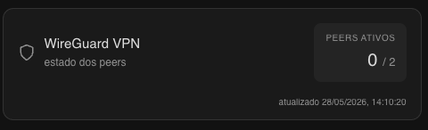
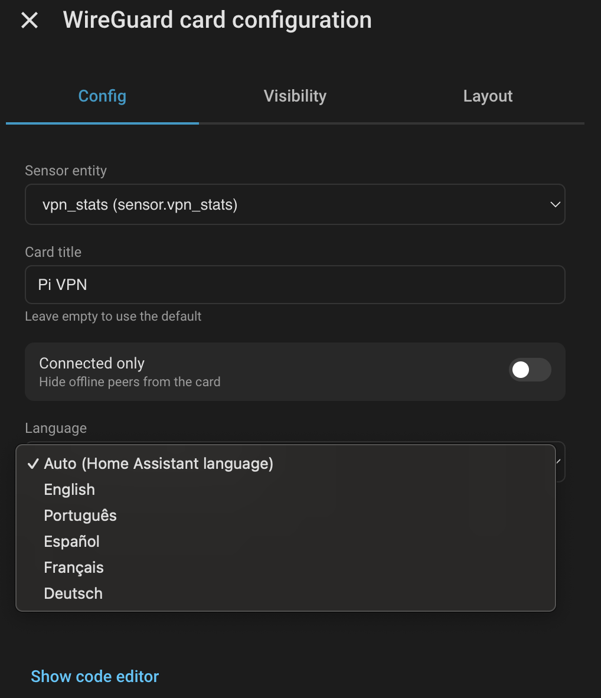

# Home Assistant Cartão WireGuard

[English](README.md) · **Português** · [Español](README.es.md) · [Français](README.fr.md) · [Deutsch](README.de.md)

Um cartão Lovelace limpo e minimalista para o [Home Assistant](https://www.home-assistant.io/) que exibe o estado dos peers WireGuard VPN — estado da ligação, endpoints, estatísticas de transferência e hora do último handshake — atualizado em tempo real a partir de um sensor REST.

---

## Pré-visualização




| Peer online | Peer offline |
|---|---|
| Ponto verde · selo `online` · handshake em segundos | Ponto cinzento · selo `offline` · handshake em horas |

Cada cartão de peer mostra:
- **Estado da ligação** — ponto e selo com código de cor
- **Endpoint** — IP pública e porta
- **IPs permitidos** — o endereço de túnel do peer
- **Último handshake** — em formato legível, destacado a verde quando o peer está online
- **Estatísticas de transferência** — rx / tx em unidades legíveis

---

## Sem YAML necessário

O cartão inclui um **editor visual** integrado, por isso pode configurá-lo diretamente na UI do painel — sem editar YAML. No editor pode alterar:

- **Entidade do sensor** — escolha a entidade `sensor.vpn_stats` que alimenta o cartão
- **Título do cartão** — substitua o título do cabeçalho, ou deixe vazio para usar o padrão localizado
- **Apenas conectados** — ative para ocultar peers desconectados
- **Idioma** — force o idioma da UI do cartão, ou deixe em `Automático` para seguir o Home Assistant
- **Configurar a API de estatísticas** — gere uma chave de acesso e obtenha um comando de instalação pronto a copiar para o servidor WireGuard

### Editor visual

O cartão inclui um editor visual, para que possa configurá-lo diretamente pela UI do painel sem mexer no YAML:

- **Entidade do sensor** — menu pendente para escolher a entidade `sensor.vpn_stats`
- **Título do cartão** — campo de texto opcional para sobrepor o título do cabeçalho; deixe vazio para usar o valor por defeito localizado
- **Apenas conectados** — opção para ocultar peers offline do cartão
- **Idioma** — menu pendente para sobrepor o idioma do cartão; por defeito `Automático (idioma do Home Assistant)`
| 
### Idiomas

O cartão atualmente traduz as suas etiquetas para os seguintes idiomas:

| Código | Idioma |
|---|---|
| `en` | English (recurso por defeito) |
| `pt` | Português |
| `es` | Español |
| `fr` | Français |
| `de` | Deutsch |

Comportamento:

- Se `language` estiver definido na configuração do cartão e corresponder a um dos códigos acima, esse idioma é usado.
- Caso contrário, o cartão lê `hass.locale.language` (o idioma do utilizador do Home Assistant). Sufixos regionais como `pt-BR` ou `en-US` são reduzidos ao seu idioma base (`pt`, `en`).
- Se o idioma resolvido não estiver na lista acima, o cartão recorre ao inglês.
- O timestamp do rodapé também é formatado com `toLocaleString(language)`, por isso o formato da data/hora segue o idioma resolvido.

> Os tempos de handshake e os volumes de transferência são formatados pelo cartão no idioma resolvido (ex: `há 5 minutos`, `1,50 GiB`) quando a API envia os campos em bruto `latest_handshake_at` e `transfer_*_bytes`, como faz o `wg-stats.py` incluído. Se a sua API só enviar o texto `latest_handshake` / `transfer_*_human`, esse texto é mostrado tal como está.

---

## Requisitos

| Requisito | Notas |
|---|---|
| Home Assistant | 2023.x ou superior |
| Um endpoint da API WireGuard | Deve expor o formato JSON descrito abaixo — instruções de configuração mais adiante |

---

## Instalação

### HACS (recomendado)

[](https://my.home-assistant.io/redirect/hacs_repository/?owner=filipeamorimdev&repository=home-assistant-wireguard-card&category=plugin)

1. Clique no botão acima ou, no HACS, abra **⋮ → Repositórios personalizados** e adicione `https://github.com/filipeamorimdev/home-assistant-wireguard-card` com o tipo **Dashboard**
2. Procure **WireGuard Card** no HACS e clique em **Download**
3. O HACS adiciona o recurso do painel automaticamente — faça um refresh forçado do navegador (`Ctrl+Shift+R`)

### Manual

1. Faça o download de `wireguard-card.js` a partir da [última versão](../../releases/latest)
2. Copie-o para `/config/www/wireguard-card.js`
3. Vá para **Definições → Painéis → ⋮ → Recursos → Adicionar recurso**
   - URL: `/local/wireguard-card.js`
   - Tipo: `Módulo JavaScript`
4. Faça um refresh forçado do navegador (`Ctrl+Shift+R`)

---

## API

Este cartão lê de um sensor REST que sonda um endpoint JSON. O endpoint deve devolver a seguinte estrutura:

```json
{
  "active_peers": 1,
  "total_peers": 2,
  "peers": {
    "peer-name": {
      "friendly_name": "peer-name",
      "endpoint": "1.2.3.4:51820",
      "allowed_ips": "10.0.0.2/32",
      "latest_handshake": "21 seconds",
      "latest_handshake_at": "2026-05-20T22:54:39+00:00",
      "transfer_rx_bytes": 3365929,
      "transfer_tx_bytes": 143843655,
      "transfer_rx_human": "3.21 MiB",
      "transfer_tx_human": "137.18 MiB",
      "rx_rate": 1520,
      "tx_rate": 48211,
      "connected": true,
      "connected_since": "2026-05-20T21:10:02+00:00"
    }
  },
  "updated_at": "2026-05-20T22:55:00.281068+00:00"
}
```

### Campos de topo

| Campo | Obrigatório | Notas |
|---|---|---|
| `peers` | ✅ | Objeto indexado pelo nome do peer. O cartão itera sobre os seus valores |
| `active_peers` | — | Mostrado na estatística do cabeçalho. Recorre ao estado do sensor se omitido |
| `total_peers` | — | Mostrado ao lado de `active_peers`. Recorre ao número de entradas em `peers` se omitido |
| `updated_at` | — | Timestamp ISO mostrado no rodapé. O rodapé fica oculto se omitido |
| `error` | — | Mostrado como aviso de erro quando presente. O script incluído define-o quando o `wg` falha |

### Campos por peer

| Campo | Obrigatório | Notas |
|---|---|---|
| `friendly_name` | ✅ | Mostrado como o título do peer |
| `endpoint` | ✅ | Mostrado tal como está (ex: `1.2.3.4:51820`) |
| `allowed_ips` | ✅ | Mostrado tal como está (ex: `10.0.0.2/32`) |
| `connected` | ✅ | Booleano. Controla o indicador online/offline e o filtro `connected_only` |
| `latest_handshake_at` | — | Timestamp ISO do último handshake. Mostrado como "há x segundos" no idioma do cartão, atualizado a cada segundo |
| `latest_handshake` | — | Texto mostrado tal como está quando `latest_handshake_at` não existe. Se nenhum estiver definido, o cartão mostra "nunca" |
| `transfer_rx_bytes` / `transfer_tx_bytes` | — | Contadores de bytes, formatados pelo cartão (ex: `1,50 GiB`) |
| `transfer_rx_human` / `transfer_tx_human` | — | Texto mostrado tal como está quando os contadores de bytes não existem |
| `rx_rate` / `tx_rate` | — | Débito atual em bytes por segundo, mostrado junto aos totais dos peers online |
| `connected_since` | — | Timestamp ISO do início da sessão atual. Mostrado como "online há" nos peers online |

O script incluído também devolve `latest_handshake_seconds_ago`, `public_key`, `persistent_keepalive`, `preshared_key` (se o peer usa uma) e um objeto `interface` de topo com a porta de escuta, a chave pública, o total de bytes e o débito total. O cartão ignora-os, mas pode usá-los em templates (adicione `interface` a `json_attributes` para o obter). Quaisquer outros campos extra também são ignorados.

`rx_rate`, `tx_rate` e `connected_since` são medidos entre pedidos, por isso são `null` até o script ter visto o peer pelo menos duas vezes. `connected_since` fica `null` para sessões que já estavam ativas quando o script arrancou.


## Configurar o serviço de API de estatísticas WireGuard

Siga estes passos para configurar uma API JSON simples para o estado do WireGuard que se integre com o Home Assistant.

### Instalação rápida (recomendado)

O script [`install.sh`](src/install.sh) faz por si todos os passos manuais abaixo em qualquer Linux com systemd (Debian, Ubuntu, Raspberry Pi OS, Fedora, Arch…). Ele:

- verifica se existem `python3` (3.7+) e `wg`, e deteta a sua interface WireGuard
- instala o `wg-stats.py` e o serviço systemd, arranca-o e confirma que responde
- por defeito escuta no IP da sua LAN e gera um token de acesso, guardado em `/etc/default/wg-stats` (legível apenas pelo root)
- mostra a configuração do sensor do Home Assistant pronta a colar, já com o seu endereço e token

Faça o download, leia-o e execute-o no servidor WireGuard:

```bash
curl -fsSLO https://github.com/filipeamorimdev/home-assistant-wireguard-card/releases/latest/download/install.sh
less install.sh
sudo bash install.sh
```

Ou numa só linha:

```bash
curl -fsSL https://github.com/filipeamorimdev/home-assistant-wireguard-card/releases/latest/download/install.sh | sudo bash
```

| Comando | O que faz |
|---|---|
| `sudo bash install.sh` | Instala, ou altera as definições de uma instalação existente (os valores atuais são os predefinidos) |
| `sudo bash install.sh upgrade` | Atualiza o script e o serviço para a versão transferida, mantendo as definições e o token |
| `sudo bash install.sh --new-token` | Substitui o token de acesso (atualize depois o `secrets.yaml`) |
| `sudo bash install.sh --token CHAVE` | Usa uma chave de acesso que já tem, como a gerada no editor do cartão |
| `sudo bash install.sh uninstall` | Para e remove o serviço. Adicione `--purge` para apagar também as definições e o token |

Execute `bash install.sh --help` para ver todas as opções, por exemplo `--interface wg1 --listen 192.168.1.10 --port 8888 --yes` para uma instalação sem perguntas.

### Configuração guiada a partir do Home Assistant

Prefere começar pelo Home Assistant? O editor do cartão cria a chave de acesso e dá-lhe o comando de instalação já com ela. A chave é gerada no navegador e nunca fica guardada na configuração do cartão.

1. **Adicione o cartão.** Instale o cartão ([HACS](#hacs-recomendado) ou [manual](#manual)), abra um painel, clique em **Editar painel → Adicionar cartão** e escolha **WireGuard Card**. Um erro na pré-visualização é normal por agora, porque o sensor ainda não existe.
2. **Gere uma chave.** No fim do editor do cartão, expanda **Configurar a API de estatísticas** e clique em **Gerar chave de acesso**. Mantenha o editor aberto até copiar as duas linhas abaixo. Se o fechar, basta gerar uma chave nova.
3. **Instale no servidor WireGuard.** Copie o comando de instalação, abra um terminal na máquina onde corre o WireGuard (por exemplo, por SSH) e cole-o. O instalador faz algumas perguntas: prima Enter para aceitar os valores predefinidos (escolha `127.0.0.1` como endereço só se o Home Assistant correr nessa mesma máquina). No fim, verifica que a API responde e mostra uma configuração do sensor. Mantenha essa saída aberta.
4. **Guarde a chave no Home Assistant.** Copie a segunda linha do editor do cartão (`wg_stats_auth: "Bearer …"`) e adicione-a ao `secrets.yaml` na pasta de configuração do Home Assistant (por exemplo, com o add-on File editor ou Studio Code Server).
5. **Adicione o sensor.** Cole no `configuration.yaml` o bloco `sensor:` que o instalador mostrou. Se já tiver uma secção `sensor:`, acrescente-lhe apenas as linhas a partir de `- platform: rest`. Pode ignorar a linha do `secrets.yaml` que o instalador mostra: já a adicionou no passo 4.
6. **Reinicie o Home Assistant.** Vá a **Definições → Sistema → Reiniciar** (ou primeiro a **Ferramentas de Programador → YAML → Verificar configuração**, para apanhar erros).
7. **Escolha o sensor.** Edite novamente o cartão, escolha **sensor.vpn_stats** em **Entidade do sensor** e clique em **Guardar**. Os peers aparecem em `scan_interval` segundos (10 por predefinição).

Opcional: [mantenha a base de dados pequena](#manter-a-base-de-dados-pequena) excluindo o sensor do recorder.

Não funciona? Teste a API a partir da máquina do Home Assistant, substituindo o endereço e a chave pelos seus. Um `401` significa que a chave no `secrets.yaml` não é igual à do servidor: execute de novo o comando de instalação com a chave do `secrets.yaml`, ou gere uma chave nova e atualize ambos.

```bash
curl -H "Authorization: Bearer <chave>" http://<ip-do-servidor-wireguard>:8888
```

### Instalação manual

Prefere configurar à mão? Siga estes passos.

#### 1. Criar o script da API

Crie o script da API com o seu editor preferido:

```bash
sudo nano /usr/local/bin/wg-stats.py
```

Pode encontrar um script de exemplo em [`src/wg-stats.py`](src/wg-stats.py).  
Modifique-o conforme necessário para o seu ambiente.

#### 2. Tornar o script executável

```bash
sudo chmod +x /usr/local/bin/wg-stats.py
```

#### 3. Criar um serviço systemd

Configure um serviço para executar o script automaticamente:

```bash
sudo nano /etc/systemd/system/wg-stats.service
```

Exemplo de [`wg-stats.service`](src/wg-stats.service) disponível neste repositório para referência.  
Certifique-se de atualizar `ExecStart` se o seu caminho do Python for diferente.

#### 4. Recarregar o systemd

Recarregue o systemd para que detete o novo serviço:

```bash
sudo systemctl daemon-reload
```

#### 5. Ativar o serviço no arranque

Ative o serviço para que seja iniciado no arranque do sistema:

```bash
sudo systemctl enable wg-stats
```

#### 6. Iniciar o serviço

Inicie já o serviço de estatísticas do WireGuard:

```bash
sudo systemctl start wg-stats
```

#### 7. Verificar que está tudo a funcionar

Verifique o estado do serviço:

```bash
sudo systemctl status wg-stats
```

Deverá ver que o serviço está ativo (a correr).  
Se sim, o endpoint da sua API está pronto a ser usado pelo Home Assistant.

> ⚠️ **Nota de segurança:** O `wg-stats.py` de exemplo escuta em `0.0.0.0:8888` **sem autenticação e sem TLS**, por isso qualquer host na mesma rede pode ler a topologia do seu WireGuard — nomes dos peers, endpoints, IPs permitidos e estatísticas de transferência. Antes de o expor, considere uma ou mais das seguintes opções:
> - Defina `WG_STATS_LISTEN` (por exemplo, em `/etc/default/wg-stats`) para escutar num endereço específico em vez de `0.0.0.0` — o IP só da sua LAN, ou `127.0.0.1` se o Home Assistant correr no mesmo host.
> - Defina `WG_STATS_TOKEN` para exigir um cabeçalho `Authorization: Bearer <token>` — por exemplo `WG_STATS_TOKEN=<string aleatória longa>` em `/etc/default/wg-stats` (`chmod 600`), seguido de `sudo systemctl restart wg-stats` — e adicione os `headers` correspondentes ao sensor REST (ver abaixo).
> - Restrinja o acesso com uma regra de firewall que permita apenas o seu host do Home Assistant.
> - Nunca exponha a porta `8888` diretamente à internet. Se precisar de acesso remoto, coloque-a atrás de um proxy reverso com autenticação/TLS, ou aceda através da própria VPN.
>
> O instalador rápido aplica as duas primeiras por si.

---

## Configuração do sensor

> Usou o instalador rápido? Ele já mostrou este bloco com o seu endereço e token — cole esse.

Adicione o seguinte ao seu `configuration.yaml`:

```yaml
sensor:
  - platform: rest
    name: vpn_stats
    unique_id: wireguard_vpn_stats
    resource: http://<o-seu-host-da-api>:<porta>
    scan_interval: 10
    # Apenas se WG_STATS_TOKEN estiver definido no host da API:
    # headers:
    #   Authorization: !secret wg_stats_auth   # "Bearer <token>" no secrets.yaml
    value_template: "{{ value_json.active_peers }}"
    unit_of_measurement: peers
    json_attributes:
      - active_peers
      - total_peers
      - peers
      - updated_at
      - error
```

Substitua `<o-seu-host-da-api>:<porta>` pelo endereço da sua API WireGuard.

| Campo | Descrição |
|---|---|
| `unique_id` | Permite a gestão da entidade pela UI |
| `scan_interval` | Frequência de sondagem em segundos — 10 é um valor por defeito sensato |
| `value_template` | Define o estado do sensor como a contagem de peers ativos |
| `unit_of_measurement` | Etiqueta o valor do estado no histórico e no diário |
| `json_attributes` | Extrai os dados aninhados para atributos da entidade para o cartão ler |

Após editar `configuration.yaml`, recarregue a sua configuração do HA (**Ferramentas de Programador → YAML → Recarregar todo o YAML**) ou reinicie o Home Assistant.

### Manter a base de dados pequena

O atributo `peers` muda a cada pedido (tempos de handshake, débitos, `updated_at`), por isso o recorder do Home Assistant guarda uma nova cópia a cada `scan_interval`: cerca de 8 600 cópias por dia com 10 segundos. O Home Assistant também deixa de gravar atributos com mais de 16 KB, o que este sensor atinge a partir de cerca de 25 peers.

O cartão só precisa do estado atual, por isso exclua o sensor do recorder:

```yaml
recorder:
  exclude:
    entities:
      - sensor.vpn_stats
```

Isto também remove o histórico do número de peers ativos. Se o quiser manter, crie um template sensor com `state: "{{ states('sensor.vpn_stats') }}"`. Esse grava apenas o número, sem os atributos.

---

## Configuração do cartão

Adicione o cartão a qualquer painel Lovelace:

```yaml
type: custom:wireguard-card
entity: sensor.vpn_stats
```

Quando adiciona o cartão pelo seletor de cartões, é pré-selecionada a primeira entidade `sensor.*` que expõe um atributo `peers` (ou, na falta dela, uma cujo ID contenha `vpn`) — normalmente `sensor.vpn_stats` — por isso muitas vezes pode confirmar sem alterar nada.

### Opções

| Opção | Obrigatório | Por defeito | Descrição |
|---|---|---|---|
| `entity` | ✅ | — | A entidade `sensor.vpn_stats` criada acima |
| `title` | — | _localizado_ `"WireGuard VPN"` | Texto personalizado mostrado como o título do cabeçalho do cartão. Se omitido, é usado o valor por defeito localizado |
| `connected_only` | — | `false` | Quando `true`, oculta peers cujo campo `connected` não seja `true`, deixando apenas os atualmente ligados |
| `language` | — | _idioma do utilizador do Home Assistant_ | Força o idioma da UI do cartão. Veja [Idiomas](#idiomas) para valores suportados. Se omitido, o cartão usa o idioma do utilizador do Home Assistant e recorre ao inglês se não for suportado |

Exemplo com um título personalizado, peers offline ocultados e a UI forçada para português:

```yaml
type: custom:wireguard-card
entity: sensor.vpn_stats
title: VPN de Casa
connected_only: true
language: pt
```

---

## Resolução de problemas

**O cartão mostra "Entity not found"**
→ Verifique se o sensor está carregado e se o ID da entidade corresponde exatamente (`sensor.vpn_stats` por defeito).

**Peers não aparecem**
→ Confirme que `peers` está listado em `json_attributes` na configuração do sensor e que a API está a devolver um objeto JSON válido sob essa chave.

**Os dados estão desatualizados**
→ Verifique o timestamp `updated_at` mostrado no fundo do cartão. Se não estiver a atualizar, verifique se a API está acessível a partir do HA e se `scan_interval` está definido.

**O cartão não aparece no seletor de cartões**
→ Certifique-se de que o recurso foi adicionado corretamente e que fez um refresh forçado (`Ctrl+Shift+R`).

**O cartão mostra "Erro da API"**
→ O serviço `wg-stats` não conseguiu ler o estado do WireGuard. Veja os detalhes com `sudo journalctl -u wg-stats` (`WG_STATS_INTERFACE` errada, `wg` não instalado, etc.).

---

## Contribuir

Pull requests são bem-vindas. Por favor, abra primeiro uma issue para alterações significativas.
